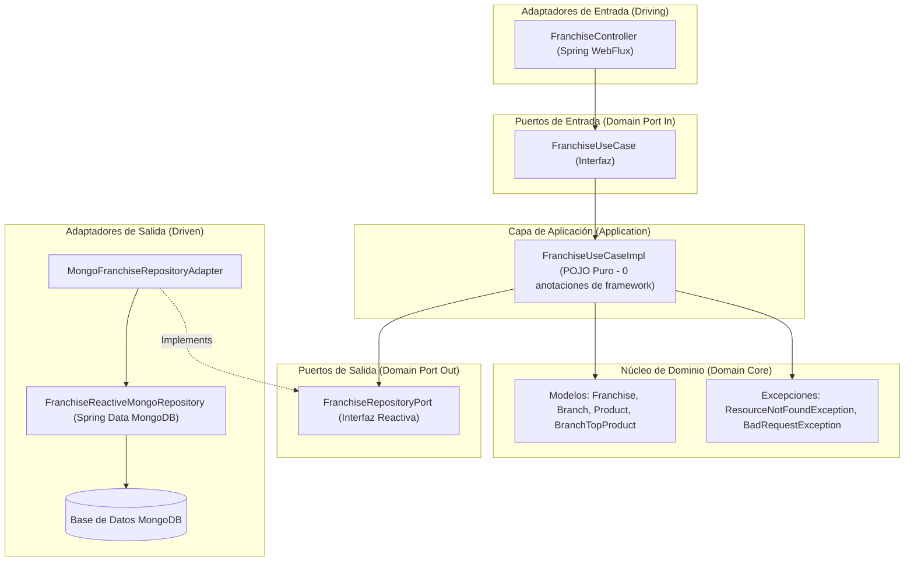

# Franchises Management Reactive REST API

API REST reactiva y no bloqueante para la administración integral de **Franquicias, Sucursales y Productos con control de inventario**, implementada bajo los principios de **Clean Architecture (Hexagonal / Ports and Adapters)**, **Spring Boot 3 WebFlux** y **MongoDB Reactivo**.

---

## 🏛️ 1. Arquitectura y Principios de Diseño

El proyecto adopta **Clean Architecture (Arquitectura Limpia)** garantizando la total independencia de las reglas de negocio respecto a frameworks web, bases de datos o librerías externas. La regla de dependencia apunta siempre hacia el centro (Dominio).



### Principales aspectos de la arquitectura:
- **Capa de Dominio (`domain`)**: 100% pura en Java 21, sin dependencias de Spring, Spring Data o Jakarta EE. Define las entidades de dominio inmutables (`Franchise`, `Branch`, `Product` con campos `private final`, sin setters, `@Getter`, `@Builder(toBuilder = true)` y colecciones envueltas con copia defensiva en `Collections.unmodifiableList`, además del `record` `BranchTopProduct`), excepciones de negocio y los contratos de entrada (`FranchiseUseCase`) y salida (`FranchiseRepositoryPort`).
- **Capa de Aplicación (`application.usecase`)**: Implementación funcional y reactiva de los casos de uso (`FranchiseUseCaseImpl`), libre de `@Service` o `@Component`. El bean se expone mediante `UseCaseConfig` en infraestructura.
- **Capa de Infraestructura (`infrastructure`)**:
  - `adapter.in.web`: Controlador REST reactivo, DTOs (`record`), validaciones Jakarta, manejador global de excepciones (`GlobalExceptionHandler`) y mapper web (`FranchiseRestMapper`).
  - `adapter.out.mongodb`: Driven adapter implementando `FranchiseRepositoryPort`, documentos con colecciones de MongoDB y mapeador tipado.
  - `config`: Configuración de OpenAPI / Swagger y registro de Beans de aplicación.

---

## 🚀 2. Stack Tecnológico

| Componente | Tecnología | Versión |
| :--- | :--- | :--- |
| **Lenguaje** | Java (LTS) | 21 |
| **Framework Base** | Spring Boot | 3.3.5 |
| **Programación Reactiva** | Project Reactor & Spring WebFlux | 3.3.5 / Reactor 3.6 |
| **Persistencia Reactiva** | Spring Data Reactive MongoDB | 3.3.5 |
| **Base de Datos** | MongoDB | 7.0 |
| **Validación** | Jakarta Validation (Hibernate Validator) | 3.0 |
| **Documentación API** | Springdoc OpenAPI Starter WebFlux UI | 2.6.0 |
| **Productividad** | Project Lombok | 1.18.34 |
| **Pruebas** | JUnit 5, Mockito, Reactor Test (`StepVerifier`), `WebTestClient` | 3.3.5 |
| **Contenedorización** | Docker (Multi-stage build con usuario no-root) | Alpine JRE 21 |
| **Orquestación Local** | Docker Compose | v2+ |
| **Infraestructura como Código (IaC)** | Terraform (MongoDB Atlas Provider en AWS) | >= 1.5.0 |

> 📄 Para consultar la lista completa, el desglose de versiones y el árbol de dependencias resuelto, consulta [DEPENDENCIES.md](./DEPENDENCIES.md) y [dependencies.txt](./dependencies.txt).

---

## ⚙️ 3. Requisitos Previos y Ejecución Local

### Opción 1: Con Docker Compose (Recomendada)

Levanta la base de datos MongoDB 7.0 (con persistencia en volumen y healthcheck) y la API en contenedores aislados:

```bash
docker compose up -d --build
```

Para verificar que los contenedores están arriba y saludables:
```bash
docker compose ps
```

Para consultar los logs en vivo:
```bash
docker compose logs -f franchises-api
```

Para detener los servicios:
```bash
docker compose down
```

---

### Opción 2: Con Maven Local

Requiere Java 21 y una instancia local de MongoDB corriendo en `localhost:27017` (o una cadena en `MONGODB_URI`):

```bash
# En Linux/macOS
export MONGODB_URI="mongodb://localhost:27017/franchises"
mvn spring-boot:run

# En Windows (PowerShell)
$env:MONGODB_URI="mongodb://localhost:27017/franchises"
mvn spring-boot:run
```

> **⚠️ Nota de despliegue sobre el índice único de franquicias (`uk_franchise_name_ci`)**:
> Al iniciar la aplicación con `spring.data.mongodb.auto-index-creation: true`, MongoDB crea automáticamente el índice único `uk_franchise_name_ci` sobre el campo `name` con colación *case-insensitive* (`locale: 'en', strength: 2`). Si despliegas sobre una base de datos preexistente que ya contenga documentos en la colección `franchises`, **debes limpiar o consolidar previamente cualquier nombre de franquicia duplicado (ignorando mayúsculas/minúsculas)** antes de que se cree el índice; de lo contrario, MongoDB rechazará la construcción del índice con `E11000 duplicate key error`.
> *(Limitación de pruebas: dado que `FranchisesApplicationTests` desactiva `auto-index-creation` para aislar la carga del contexto sin requerir un servidor MongoDB activo, la creación efectiva del índice `uk_franchise_name_ci` y su colación fueron verificadas manualmente contra el contenedor MongoDB real y no mediante un test automatizado).*

---

## 📖 4. Documentación Interactiva (Swagger UI)

Una vez iniciada la aplicación, la documentación interactiva y el explorador OpenAPI están disponibles en:

- **Swagger UI**: [http://localhost:8080/swagger-ui.html](http://localhost:8080/swagger-ui.html)
- **OpenAPI 3.0 JSON Spec**: [http://localhost:8080/v3/api-docs](http://localhost:8080/v3/api-docs)

---

## 📋 5. Referencia de Endpoints y Ejemplos `curl`

Ruta base de la API: `/api/v1/franchises`

| # | Método | Endpoint | Descripción | Código HTTP |
| :--- | :--- | :--- | :--- | :--- |
| **1** | `POST` | `/api/v1/franchises` | Crear una nueva franquicia | `201 Created` |
| **2** | `GET` | `/api/v1/franchises` | Listar todas las franquicias (sin paginación, ordenadas por `name` e `id`) | `200 OK` |
| **3** | `GET` | `/api/v1/franchises/{fId}` | Obtener una franquicia por ID con sus sucursales y productos | `200 OK` / `404` |
| **4** | `POST` | `/api/v1/franchises/{fId}/branches` | Agregar una sucursal a una franquicia | `201 Created` |
| **5** | `POST` | `/api/v1/franchises/{fId}/branches/{bId}/products` | Agregar un producto con stock a una sucursal | `201 Created` |
| **6** | `DELETE`| `/api/v1/franchises/{fId}/branches/{bId}/products/{pId}` | Eliminar un producto de una sucursal | `204 No Content` |
| **7** | `PATCH`| `/api/v1/franchises/{fId}/branches/{bId}/products/{pId}/stock` | Modificar el stock de un producto | `200 OK` |
| **8** | `GET` | `/api/v1/franchises/{fId}/top-stock-products` | Obtener el producto con más stock por sucursal | `200 OK` |
| **9** | `PATCH`| `/api/v1/franchises/{fId}/name` | [PLUS] Actualizar el nombre de una franquicia | `200 OK` |
| **10** | `PATCH`| `/api/v1/franchises/{fId}/branches/{bId}/name` | [PLUS] Actualizar el nombre de una sucursal | `200 OK` |
| **11** | `PATCH`| `/api/v1/franchises/{fId}/branches/{bId}/products/{pId}/name` | [PLUS] Actualizar el nombre de un producto | `200 OK` |

> **ℹ️ Notas de comportamiento en los endpoints**:
> - **Validación de longitud de nombres (`NAME_MAX_LENGTH = 100`)**: En los 6 endpoints que reciben `name` (`CreateFranchiseRequest`, `CreateBranchRequest`, `CreateProductRequest` y `UpdateNameRequest`) y en la validación de negocio `requireNonBlankName`, el límite máximo de **100 caracteres se mide sobre la cadena recibida sin `trim`** (antes de recortar espacios laterales); una vez superada la validación de longitud y no-vacío, el nombre se normaliza con `trim()` para su almacenamiento y comparación de unicidad.
> - **Listado sin paginación (`GET /api/v1/franchises`)**: Retorna todas las franquicias de la colección ordenadas de forma determinista por `name` (ascendente) y luego por `id` (ascendente), sin paginación. Esta operación es **100% de solo lectura** (no realiza escrituras en MongoDB ni altera documentos legados sin campo `version`).
> - **Consulta por ID (`GET /api/v1/franchises/{fId}`)**: Reutiliza `findById`, por lo que si el documento consultado es un **documento legado sin campo `version`**, inicializa atómicamente `version = 0` en MongoDB para dejarlo preparado ante futuras actualizaciones con bloqueo optimista (`@Version`). En ningún caso se expone el campo `version` en el DTO de respuesta `FranchiseResponse`.

---

### Ejemplos `curl` listos para probar

#### 1. Crear franquicia
```bash
curl -X POST http://localhost:8080/api/v1/franchises \
  -H "Content-Type: application/json" \
  -d '{"name": "McDonalds"}'
```

#### 1.1. Listar todas las franquicias
```bash
curl -X GET http://localhost:8080/api/v1/franchises
```

#### 1.2. Consultar una franquicia por ID
```bash
curl -X GET http://localhost:8080/api/v1/franchises/<FRANCHISE_ID>
```

#### 2. Agregar sucursal a una franquicia
```bash
curl -X POST http://localhost:8080/api/v1/franchises/<FRANCHISE_ID>/branches \
  -H "Content-Type: application/json" \
  -d '{"name": "Sucursal Chapinero"}'
```

#### 3. Agregar producto a una sucursal
```bash
curl -X POST http://localhost:8080/api/v1/franchises/<FRANCHISE_ID>/branches/<BRANCH_ID>/products \
  -H "Content-Type: application/json" \
  -d '{"name": "Big Mac", "stock": 50}'
```

#### 4. Eliminar producto de una sucursal
```bash
curl -X DELETE http://localhost:8080/api/v1/franchises/<FRANCHISE_ID>/branches/<BRANCH_ID>/products/<PRODUCT_ID>
```

#### 5. Modificar stock de un producto
```bash
curl -X PATCH http://localhost:8080/api/v1/franchises/<FRANCHISE_ID>/branches/<BRANCH_ID>/products/<PRODUCT_ID>/stock \
  -H "Content-Type: application/json" \
  -d '{"stock": 120}'
```

#### 6. Consultar producto con mayor stock por sucursal
```bash
curl -X GET http://localhost:8080/api/v1/franchises/<FRANCHISE_ID>/top-stock-products
```

#### 7. [PLUS] Actualizar nombre de franquicia
```bash
curl -X PATCH http://localhost:8080/api/v1/franchises/<FRANCHISE_ID>/name \
  -H "Content-Type: application/json" \
  -d '{"name": "McDonalds Premium"}'
```

#### 8. [PLUS] Actualizar nombre de sucursal
```bash
curl -X PATCH http://localhost:8080/api/v1/franchises/<FRANCHISE_ID>/branches/<BRANCH_ID>/name \
  -H "Content-Type: application/json" \
  -d '{"name": "Sucursal Zona T"}'
```

#### 9. [PLUS] Actualizar nombre de producto
```bash
curl -X PATCH http://localhost:8080/api/v1/franchises/<FRANCHISE_ID>/branches/<BRANCH_ID>/products/<PRODUCT_ID>/name \
  -H "Content-Type: application/json" \
  -d '{"name": "Big Mac Doble Queso"}'
```

---

## 🧪 6. Ejecución de Pruebas

Para ejecutar la suite completa de pruebas unitarias y de integración:

```bash
mvn clean test
```

### Desglose de las 45 pruebas automatizadas:
- **`FranchiseUseCaseImplTest` (27 pruebas)**: Cobertura exhaustiva de los 9 casos de uso reactivos en escenarios exitosos (mutación de datos en memoria y persistencia), validación estricta de no invocación a `save()` ante errores 404 (`ResourceNotFoundException`), omisión de sucursales sin productos y desempate exacto de stock preservando el primer producto encontrado.
- **`FranchiseControllerTest` (14 pruebas)**: Pruebas con `WebTestClient` sobre los 9 endpoints REST reactivos, validación de esquemas JSON y códigos HTTP (`201`, `200`, `204`), respuestas controladas de validación `400 Bad Request` por nombres en blanco o stock negativo (`-1`), manejo de `404 Not Found` y errores genéricos `500 Internal Server Error`.
- **`MongoFranchiseRepositoryAdapterTest` (3 pruebas)**: Verificación del mapeo y persistencia reactiva contra MongoDB utilizando `StepVerifier`.
- **`FranchisesApplicationTests` (1 prueba)**: Prueba de carga y verificación de integridad del contexto reactivo de Spring Boot.

---

## ☁️ 7. Infraestructura como Código (Terraform) y Despliegue Cloud

La carpeta `terraform/` contiene los manifiestos para aprovisionar un clúster de **MongoDB Atlas en AWS**:

```text
terraform/
├── versions.tf                  # Provider mongodb/mongodbatlas ~> 1.15
├── variables.tf                 # Variables configurables (región, tier, usuario, etc.)
├── main.tf                      # Proyecto, Cluster M0 en AWS, Usuario y Access List
├── outputs.tf                   # URI reactiva mongodb_connection_uri (sensitive)
└── terraform.tfvars.example     # Plantilla de valores de configuración
```

### Pasos para desplegar la base de datos en MongoDB Atlas:

1. **Configurar credenciales**:
   Copia el archivo de ejemplo y ajusta tus claves de API de MongoDB Atlas (`db_username` y `db_password` deben definirse en **texto plano y sin pre-codificar**, ya que `mongodbatlas_database_user` recibe las credenciales literales y `outputs.tf` se encarga automáticamente de aplicar URL-encoding al construir `mongodb_connection_uri`):
   ```bash
   cd terraform
   cp terraform.tfvars.example terraform.tfvars
   ```

2. **Inicializar y validar Terraform**:
   ```bash
   terraform init
   terraform validate
   ```

3. **Planificar y aplicar**:
   ```bash
   terraform plan -out=tfplan
   terraform apply tfplan
   ```

4. **Obtener la URI de conexión generada**:
   ```bash
   terraform output -raw mongodb_connection_uri
   ```

### Despliegue Cloud Continuo con Render (`render.yaml`):

El proyecto incluye el descriptor declarativo [render.yaml](file:///C:/Desarrollo/franchises/render.yaml) configurado para construir el contenedor Docker multi-stage de la aplicación en la nube. Simplemente conecta el repositorio GitHub en Render y suministra el valor de `MONGODB_URI` obtenido del output de Terraform.
